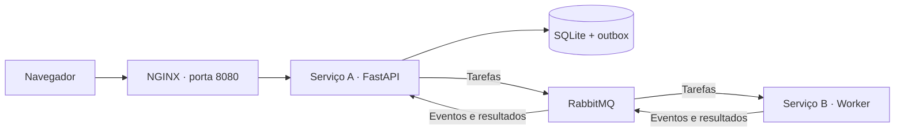

# BattleSim — Simulador de Batalhas RPG

Crie um herói, escolha sua classe e conquiste cinco fases com melhorias por vitória. Também é possível selecionar dois combatentes e acompanhar duelos por turnos processados de forma assíncrona. Projeto acadêmico de **Serviços em Nuvem — Engenharia da Computação**.

A primeira entrega usa Python, FastAPI, SQLite, RabbitMQ, NGINX, Docker Compose e HTML/CSS/JavaScript. O foco é demonstrar uma arquitetura distribuída pequena, observável e reproduzível.

## Executar

Requisitos: Docker Engine com Compose v2 ou superior, ou Docker Desktop com backend Linux/WSL2 em execução. Python local não é necessário para executar os containers.

1. Copie `.env.example` para `.env`:
   - PowerShell: `Copy-Item .env.example .env`
   - Linux/macOS: `cp .env.example .env`
2. Escolha uma senha local em `RABBITMQ_PASSWORD`. Use letras, números, hífen e underscore para que a senha seja válida diretamente na URL AMQP.
3. Inicie:

```bash
docker compose up --build -d
docker compose ps
```

Abra **http://127.0.0.1:8080**. Em **Aventura**, dê um nome ao herói, escolha Guerreiro, Mago ou Arqueiro, distribua cinco pontos e entre na primeira fase. A luta é automática: acompanhe a animação ou avance até o desfecho. Clique em **Continuar** e escolha uma melhoria. O progresso fica salvo no servidor; o navegador lembra o último herói. **Continuar um herói salvo** permite recuperar outra aventura nesta instalação.

Para duelos livres, crie pelo menos dois personagens em **Personagens**, selecione-os na **Arena** e clique em **Iniciar batalha**. Consulte detalhes em **Histórico** e gere lotes em **Teste de carga**. A implantação Kubernetes e o roteiro de HPA estão em [k8s/README.md](k8s/README.md).

O cluster local configurado no Docker Desktop usa **http://localhost:8081**, com uma base separada do Compose. Consulte [como iniciar o acesso local](k8s/local-setup.md) e as [evidências de implantação, reposição e HPA](docs/kubernetes-validation.md).

A porta pode ser alterada em `APP_PORT`. Documentação interativa: **http://localhost:8080/api/docs**; contrato OpenAPI: **/api/openapi.json**. A interface principal e sua fonte são locais; o Swagger UI usa o CDN configurado pelo FastAPI e precisa de acesso à internet no navegador.

```bash
docker compose logs -f nginx service-a service-b
docker compose stop
docker compose start
docker compose down
```

`stop` e `down` preservam os volumes. Para uma limpeza intencional dos dados, `docker compose down -v` apaga **personagens, batalhas e dados do RabbitMQ**.

## Arquitetura



| Componente | Responsabilidade |
| --- | --- |
| nginx | Serve o frontend e encaminha /api; único serviço com porta publicada. |
| service-a | Valida personagens e batalhas, mantém SQLite, publica a outbox e consome resultados. Uma réplica e um processo. |
| service-b | Consome tarefas, executa o motor de combate e publica eventos. Pode ter várias réplicas. |
| rabbitmq | Filas duráveis, distribuição de tarefas, eventos e descarte de mensagens inválidas. |

NGINX participa da rede de entrada `edge` e da rede `internal`. Os outros componentes participam somente de `internal`, criada com `internal: true`. Nenhuma porta da API ou do RabbitMQ é publicada. Não existe chamada direta entre A e B nem acesso do worker ao SQLite.

A API registra batalha e outbox na mesma transação antes de retornar **HTTP 202**. A publicação pode acontecer depois dessa resposta, inclusive após recuperação do broker. O worker confirma uma tarefa somente depois de publicar o resultado com confirmação do broker. A entrega pode ocorrer mais de uma vez; a gravação de resultados é idempotente. Detalhes e limites em [docs/architecture.md](docs/architecture.md).

## API

| Método | Caminho | Uso |
| --- | --- | --- |
| GET | /api/health | Estado de banco e conexão ao broker |
| GET | /api/health/live | Processo HTTP vivo |
| GET | /api/health/ready | 200 quando pronto; 503 com broker indisponível |
| POST / GET | /api/characters | Criar / listar personagens |
| GET | /api/characters/{id} | Consultar personagem |
| POST | /api/battles | Solicitar batalha; retorna 202 |
| GET | /api/battles | Histórico paginado; filtros status e batch_id |
| GET | /api/battles/{id} | Resultado e ataques |
| POST | /api/battles/batch | Lote de 1 a 1000 batalhas; retorna 202 |
| GET | /api/stats | Estados, tempo médio e distribuição por worker |
| GET | /api/adventures/catalog | Classes, cinco fases e ganhos por atributo |
| POST / GET | /api/adventures | Criar herói com cinco pontos / listar aventuras |
| GET | /api/adventures/{id} | Herói, nível, fase e recompensa pendente |
| POST | /api/adventures/{id}/battles | Solicitar tentativa da fase atual; retorna 202 |
| POST | /api/adventures/{id}/upgrades | Escolher melhoria com attribute e battle_id |

Listagens retornam `items`, `total`, `limit` e `offset`. Personagens: limite padrão 50, máximo 100. Batalhas: padrão 20, máximo 100. Estados: `pending`, `processing`, `completed`, `failed`.

Na aventura, os cinco pontos iniciais rendem +12 de vida, +3 de ataque, +2 de defesa ou +2 de velocidade por ponto. Vitória sobe um nível e permite escolher +20 de vida, +4 de ataque, +3 de defesa ou +3 de velocidade. Derrota, empate e falha permitem repetir a fase com vida cheia; não concedem avanço. A quinta recompensa conclui a aventura no nível 6. Os adversários usam as três classes existentes. Não há comandos manuais, inventário, experiência fracionada ou combate em equipe nesta etapa.

Tentativas simultâneas compartilham a batalha pendente. Resultado e progresso são gravados na mesma transação; recompensas são vinculadas à batalha e idempotentes. Uma repetição da mesma escolha não concede atributos novamente. Os snapshots dos confrontos anteriores preservam os atributos usados naquela luta. Esta instalação acadêmica compartilha os heróis entre os visitantes e não possui contas ou autenticação.

Exemplo em PowerShell:

```powershell
$base = 'http://localhost:8080/api'
$mage = @{ name='Lyra'; class_name='mage'; hp=100; attack=75; defense=15; speed=55 } | ConvertTo-Json
$warrior = @{ name='Kael'; class_name='warrior'; hp=160; attack=45; defense=40; speed=30 } | ConvertTo-Json
$a = Invoke-RestMethod "$base/characters" -Method Post -ContentType 'application/json' -Body $mage
$b = Invoke-RestMethod "$base/characters" -Method Post -ContentType 'application/json' -Body $warrior
$pair = @{ character_a_id=$a.id; character_b_id=$b.id }
$battle = Invoke-RestMethod "$base/battles" -Method Post -ContentType 'application/json' -Body ($pair | ConvertTo-Json)
Invoke-RestMethod "$base/battles/$($battle.id)"
$pair.count = 100
Invoke-RestMethod "$base/battles/batch" -Method Post -ContentType 'application/json' -Body ($pair | ConvertTo-Json)
```

Classes: `warrior`, `mage`, `archer`. Limites: nome de 1 a 60 caracteres; vida 1–1000; ataque 1–200; defesa 0–150; velocidade 1–100. Classes fornecem presets na interface; não acrescentam poderes especiais.

Na arena 2D, o aliado aparece de costas e o adversário à frente, em um cenário colorido com sprites originais. Cada golpe anima a classe do atacante e reduz a vida no impacto. Ao fim, a tela de vitória apresenta o vencedor. **Assistir**, **Pausar**, **Avançar turno**, **Ver desfecho** e velocidades **1×/2×/4×** controlam a reprodução sem solicitar outra batalha. Com movimento reduzido, os turnos avançam por clique. Sair da arena ou ocultar a aba pausa a reprodução.

A visão de equipes, quatro classes, inimigos, chefes, cenários e progressão está organizada em [docs/game-roadmap.md](docs/game-roadmap.md). Esta entrega implementa sua base visual com os duelos existentes.

Velocidade define o primeiro atacante; empates usam a semente. Cada turno é uma ação de ataque. Dano = máximo entre 1 e a parte inteira de ataque × variação(0,9–1,1) − defesa × 0,5, limitado à vida restante. Até 200 ações por tarefa; atingir o limite sem nocaute produz empate. O mesmo snapshot e seed reproduzem o resultado.

## Demonstração de recuperação e escala

```bash
docker compose stop service-b
# Solicite batalhas pela interface: elas permanecem na fila.
docker compose up -d service-b
# As tarefas persistidas passam a ser processadas.
docker compose up -d --scale service-b=3 service-b
# Gere um lote e observe a tabela de processamento por worker.
docker compose up -d --scale service-b=1 service-b
```

Para elevar o consumo real de CPU, defina `WORKER_CPU_ITERATIONS=500000` ou `1000000` em `.env` e recrie o worker: `docker compose up -d --force-recreate service-b`. A variável aceita 0–20000000 iterações de PBKDF2 SHA-256 por batalha. A intensidade e a duração dependem do hardware. Não se usa `sleep` para representar consumo de CPU.

O worker mostra seu hostname nos resultados e logs. Métricas contam resultados únicos aceitos pelo Serviço A, não tentativas físicas duplicadas. Veja o roteiro completo em [docs/demo.md](docs/demo.md).

## Desenvolvimento e testes

Python 3.11 e [uv](https://docs.astral.sh/uv/) são usados para desenvolvimento. O `uv.lock` fixa as dependências; os Dockerfiles usam os requirements exportados desse lock.

```bash
uv sync --locked
uv run pytest -q
node --test tests/playback.test.mjs tests/adventure.test.mjs
# Com os quatro containers já em execução:
uv run pytest -m integration -v
```

Os testes de integração criam registros e interrompem/reiniciam **os workers e o broker deste projeto Compose**; use um ambiente de demonstração dedicado. Eles verificam o caminho pelo NGINX, retomada de pendências, indisponibilidade do broker, persistência e múltiplos workers.

Verificação opcional da interface: com Node.js 22+ e um navegador Chromium já instalado, execute `node tests/browser.mjs`. No Windows, o script usa o Edge no caminho padrão; em outro ambiente, informe o executável em `BROWSER_PATH`. Ele testa os fluxos pela interface, falhas de rede após uma criação confirmada e a parada da consulta de resultados concluídos, criando registros de teste. Capturas desktop/celular e relatório ficam em `.git/ui-qa/`, fora do versionamento. Nenhum navegador ou pacote npm é instalado pelo script.

Para atualizar os arquivos derivados após alterar dependências:

```bash
uv lock
uv export --no-dev --no-hashes --no-emit-project --format requirements-txt --output-file service-a/requirements.txt
uv export --no-dev --no-hashes --no-emit-project --prune fastapi --prune uvicorn --format requirements-txt --output-file service-b/requirements.txt
uv run python scripts/export_contracts.py
```

## Organização

- `contracts/`: modelos compartilhados, esquemas JSON, topologia e publicação.
- `service-a/api/`: API, SQLite/outbox e consumidor de resultados.
- `service-b/worker/`: motor puro, carga CPU e consumidor de tarefas.
- `frontend/`: interface sem framework; fonte Barlow Condensed autohospedada, licença OFL em assets.
- `nginx/`: proxy, acesso externo e correlação de requisições.
- `tests/`: regras, persistência, API, carga CPU e integração real.
- `docs/`: arquitetura e roteiro reproduzível.
- `k8s/`: manifestos Kustomize, volumes, Ingress NGINX, HPA de CPU e roteiro de validação em cluster.

Integrantes: **Cauê Kenzo Adaniya** ([Ckenz0](https://github.com/Ckenz0)), **Bruno Oliveira** ([mo-bruno](https://github.com/mo-bruno)) e **Rafael** ([RafaelBeniites](https://github.com/RafaelBeniites)). O histórico registra evolução e coautoria. Configurações locais de agentes e credenciais não fazem parte da entrega.
